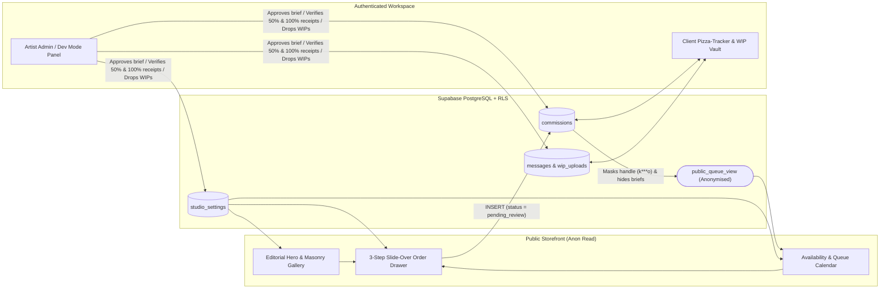

<div align="center">
  
  <h1>Meru Art — Interactive Commission Showcase & Full-Stack Client Workspace</h1>
  <p>
    A full-stack digital illustration storefront, live USD/PHP commission calculator, public queue calendar, scam-protected WIP vault, and artist backoffice built with <strong>React 19, TypeScript, Tailwind CSS v4, Framer Motion, Lenis, and Supabase (Auth, PostgreSQL RLS, Realtime & Storage)</strong>.
  </p>
  <p>
    <a href="https://meru-art-studio.vercel.app"><strong>Live Demo (Vercel)</strong></a> ·
    <a href="https://mhelric.vercel.app"><strong>Developer Portfolio (mhelric)</strong></a> ·
    <a href="https://meru_art.artstation.com"><strong>ArtStation</strong></a>
  </p>
</div>

---

## 1. Overview & Portfolio Goals

Rebuilt from a static commission page (`meru-art.carrd.co`) into a production full-stack web application designed to fulfill two featured engineering case studies on [`mhelric.vercel.app`](https://mhelric.vercel.app):

1. **Interactive Art & Commission Showcase Tool:** Blends custom digital illustration with an editorial UI (inspired by `nicolearoberts.com`), smooth Lenis scrolling, a filterable masonry gallery + lightbox, an availability/queue calendar, and a guided 3-step slide-over order drawer with live **PayPal (USD)** and **GCash (PHP)** pricing math.
2. **Full-Stack Client & Artist Workspace App:** Demonstrates OAuth authentication (Discord & Google), strict PostgreSQL **Row-Level Security (RLS)**, database-enforced spam/scam protection, watermarked WIP vaults that unlock high-resolution masters only upon completion, and an **Artist Admin / Dev Preview** control panel.

---

## 2. Architecture & User Flow



---

## 3. Key Features by Phase

### Phase 1 — Editorial Storefront, Automated Image Pipeline & Rules/TOS
- **Automated WebP & Blur-Placeholder Pipeline ([`scripts/optimize-images.mjs`](scripts/optimize-images.mjs)):** Uses `sharp` to convert raw high-res illustrations into `1800px` full-res and `720px` thumbnail WebP assets alongside base64 blur-up placeholders and exact aspect-ratio metadata ([`src/data/art-manifest.json`](src/data/art-manifest.json)) for zero layout shift (`CLS = 0`).
- **Immediate Art Showcase:** Dual counter-scrolling vertical marquee columns on desktop and a smooth horizontal showcase strip on mobile display real commissions and fanart immediately on open.
- **Filterable Masonry Gallery & Lightbox:** Filter by `All Work`, `Headshots`, `Halfbody`, `Fullbody`, `Chibis`, and `Graphics` with keyboard-navigable full-res inspection and 1-click **"Commission This Style"** pre-selection.
- **Visual Boundaries & TOS Accordion:** Side-by-side **Can Draw / Won't Draw** cards, strict **Anti-NFT & Anti-AI** policy callout, and a visual `100% → 50% → 0%` refund timeline.

### Phase 2 — Public Availability Calendar & 3-Step Order Drawer
- **Anonymised Queue & Calendar ([`AvailabilityCalendar.tsx`](src/components/schedule/AvailabilityCalendar.tsx)):** Displays live slot capacity (`Commissions: OPEN · X/5 Slots Available`), active anonymised client progress bars (`Slot #1: Fullbody — Lineart & Coloring · 78%`), blocked exam/rest dates, and clickable green open booking windows.
- **Guided 3-Step Order Drawer ([`TierModal.tsx`](src/components/portfolio/TierModal.tsx)):**
  - **Step 1 (Style & Price Calculator):** Switch tiers, character count (`1–4`), add-ons (`+50% NSFW`, `+50% Soft Furry`, `+200% Commercial`), currency (`$ USD` vs `₱ PHP`), and payment split (`50% / 50%` vs `100% Upfront`).
  - **Step 2 (Brief & References):** Attach up to 5 character reference images, enter pose/expression notes, pick a preferred start window, and check the mandatory **Terms of Service** box (logged with an ISO timestamp).
  - **Step 3 (Review & Submit Gate):** Supports 1-click **Discord / Google OAuth** sign-in as well as an instant **Recruiter / Visitor Demo Submit** mode.

### Phase 3 — Supabase Schema, Row-Level Security (RLS) & Scam Protection
Defined in [`supabase/migrations/20261031000000_meru_studio_schema.sql`](supabase/migrations/20261031000000_meru_studio_schema.sql):
- **Fair Queue Slot Protection:** New briefs are forced into `status_stage = 'pending_review'` via RLS `WITH CHECK` and the `enforce_commission_integrity()` trigger — a public slot is **never** deducted until the artist approves the brief.
- **1 Pending Request Per User Limit:** Enforced at the PostgreSQL index level (`CREATE UNIQUE INDEX idx_commissions_one_pending_per_client ON public.commissions (client_id) WHERE (status_stage = 'pending_review')`) to prevent queue spam.
- **Safe Public Queue Projection (`public_queue_view`):** Exposes only active accepted slots with masked client handles (`k***o`), keeping private character briefs, references, and chat rooms strictly locked to `client_id = auth.uid() OR public.is_artist_admin()`.

### Phase 4 — Client "Pizza-Tracker" Order Room, Watermarked Vault & Realtime Chat
- **Top Action Banner & 6-Stage Stepper ([`OrderTracker.tsx`](src/components/track/OrderTracker.tsx)):** Guides the client through `Pending Review` → `Awaiting Upfront Deposit` → `Sketching` → `Sketch Approval & Remaining 50% Gate` → `Lineart & Coloring` → `Completed`.
- **Scam-Protected WIP Vault:** Overlays a diagonal repeating `MERU ART · WIP PREVIEW` watermark over in-progress sketches and locks the final master file until `stage === 'completed'`, where the unwatermarked **Download High-Res PNG** button unlocks.
- **Realtime Order Chat:** Built-in chat room with tagged image attachments (`Receipt`, `Redline`, `Reference`).

### Phase 5 — Artist "Dev Mode" / Admin Control Panel
- **Live Storefront & Schedule Controller ([`AdminPanel.tsx`](src/components/admin/AdminPanel.tsx)):** Flip `OPEN / WAITLIST / CLOSED`, adjust max slots, click dates on the admin mini-calendar to block/unblock them, and edit USD base prices, add-on multipliers, and the PHP exchange rate live without redeploying.
- **Order, Payment & WIP Controller:** Approve or decline incoming briefs, verify 50%/100% payment receipts to unlock stages, upload new WIPs or final masters, and post messages as `Meru Art`.

---

## 4. Local Development & Setup

```bash
# 1. Install dependencies
npm install

# 2. (Optional) Regenerate optimised WebP artwork & brand assets from /assets-src
npm run images

# 3. Start the Vite dev server (http://localhost:5173)
npm run dev

# 4. Type-check & build for production
npm run build
```

### Applying the Supabase Database Migration
Open your [Supabase Dashboard → SQL Editor](https://supabase.com/dashboard/project/ikeeddqgliobgfglytgr/sql/new), paste the contents of [`supabase/migrations/20261031000000_meru_studio_schema.sql`](supabase/migrations/20261031000000_meru_studio_schema.sql), and click **Run**.

---

## 5. License & Artwork Notice

Codebase engineered by **mhelric** ([`mhelric.vercel.app`](https://mhelric.vercel.app)). All digital illustrations and character artworks in `/public/art` and `/assets-src` are © **Meru Art** — strictly no reposting, NFT minting, or AI training allowed.
